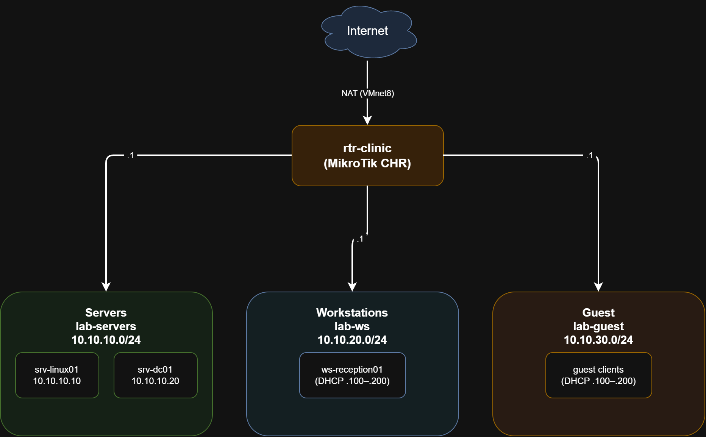

# mini-clinic-infra

A home lab that simulates the IT infrastructure of a small private clinic: segmented network, hardened Linux server, Active Directory, backups, monitoring and security testing.

I work as an assistant sysadmin in a real clinic. This project is my way to build a complete environment from scratch, understand how all the parts fit together, and document every step.

## Goals

- Design and build a small office network with segmentation and firewall rules
- Practice Linux server administration and hardening
- Set up a Windows domain (Active Directory, GPO, file shares)
- Automate backups and **test restoring them**
- Monitor the infrastructure and send alerts to Telegram
- Attack my own lab to find and fix weak points

## Network design



| Segment      | Network       | Purpose                          |
|--------------|---------------|----------------------------------|
| Servers      | 10.10.10.0/24 | Linux server, AD, monitoring     |
| Workstations | 10.10.20.0/24 | Windows clients                  |
| Guest        | 10.10.30.0/24 | Guest Wi-Fi, internet only       |

Access policy: default deny, only required traffic is allowed between segments.

## Tools

MikroTik RouterOS (CHR), Ubuntu Server, Windows Server (evaluation), AdGuard Home, restic, Zabbix, Kali Linux, nmap, Wireshark, Bash, PowerShell, Git.

## Progress

- [x] Stage 0: Project setup, network diagram, addressing plan
- [x] Stage 1: Network (router, segments, DHCP, DNS, firewall)
- [x] Stage 2: Linux server (SSH keys, ufw, fail2ban, AdGuard Home)
- [ ] Stage 3: Active Directory (domain, OU, users, GPO, file share)
- [ ] Stage 4: Backups with restore test
- [ ] Stage 5: Monitoring and Telegram alerts
- [ ] Stage 6: Security testing and hardening report
- [ ] Stage 7: Final documentation

## Repository structure

```text
docs/         step-by-step documentation for each stage
network/      router configs (secrets removed) and test results
servers/      server configs and scripts
monitoring/   monitoring setup
security/     findings and fixes
diagrams/     network diagrams
```

## Notes

This is a lab project. All passwords, keys and real IP addresses are excluded from the repository.