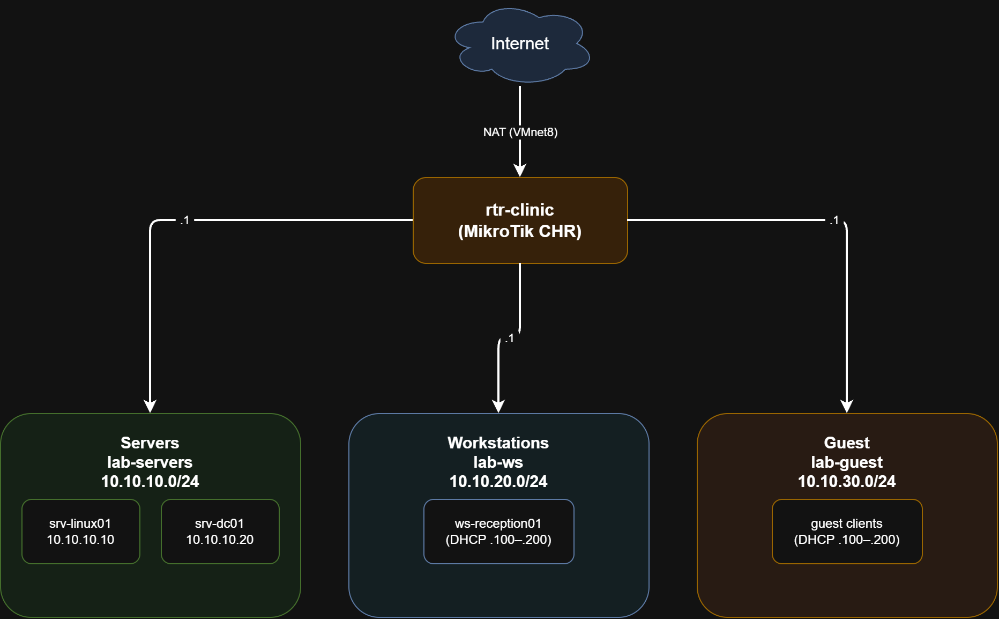

# Stage 0: Planning

## Goal
Prepare the design and the environment before building anything.

## Environment
- Host: ThinkPad T14 (Ryzen 7 Pro, 32 GB RAM), Windows 11 Pro
- Hypervisor: VMware Workstation Pro
- Images (kept outside the repository):
  - Ubuntu Server 26.04.1 LTS
  - MikroTik CHR 7.25.2 (OVA)

## Design

### Virtual networks
- WAN: VMware NAT (VMnet8, 192.168.169.0/24), internet access for the router
- Segments: VMware LAN Segments `lab-servers`, `lab-ws`, `lab-guest`
  (isolated networks, created in Stage 1 when the router VM is built)

### Addressing plan

| Host                     | Segment      | IP                 | Assignment |
|--------------------------|--------------|--------------------|------------|
| rtr-clinic (WAN)         | internet     | from VMnet8        | DHCP       |
| rtr-clinic               | Servers      | 10.10.10.1         | static     |
| rtr-clinic               | Workstations | 10.10.20.1         | static     |
| rtr-clinic               | Guest        | 10.10.30.1         | static     |
| srv-linux01              | Servers      | 10.10.10.10        | static     |
| srv-dc01                 | Servers      | 10.10.10.20        | static     |
| ws-reception01           | Workstations | 10.10.20.100-200   | DHCP       |
| guest clients            | Guest        | 10.10.30.100-200   | DHCP       |

Conventions: the gateway is always `.1`, servers have static addresses at the
bottom of the range, clients get DHCP addresses in `.100-.200`.
Host names use prefixes: `rtr-` (router), `srv-` (server), `ws-` (workstation).

### Access policy
Default deny between segments. Only required traffic is allowed.
The detailed rules are defined in Stage 1.

## Steps
1. Checked free disk space on the host.
2. Downloaded the Ubuntu Server ISO and the MikroTik CHR image.
3. Drew the network diagram in draw.io and saved the source and PNG in `diagrams/`.
4. Defined the addressing plan and the naming conventions.

## Verification
- Image files are present and have the expected sizes (CHR about 44 MB, Ubuntu ISO about 2.8 GB).
- The diagram renders in the README on GitHub.

## Problems and solutions
**1. Wrong repository name.**
I typed an extra backslash at the end of the name, and GitHub changed it to a dash.
I removed the backslash before creating the repository.

**2. The `code .` command did not work in PowerShell.**
PowerShell said the command was not found.
I opened VS Code from the taskbar and used File > Open Folder instead.

**3. Files uploaded on the GitHub website were missing on my laptop.**
I uploaded the diagram through the website, so my local folder did not have it.
I ran `git pull` to download the new files.

**4. The diagram in the README did not show.**
The README linked to `network-v1.png`, but the file was named `network-v1.drawio.png`.
I renamed the file with `git mv` and pushed the change.